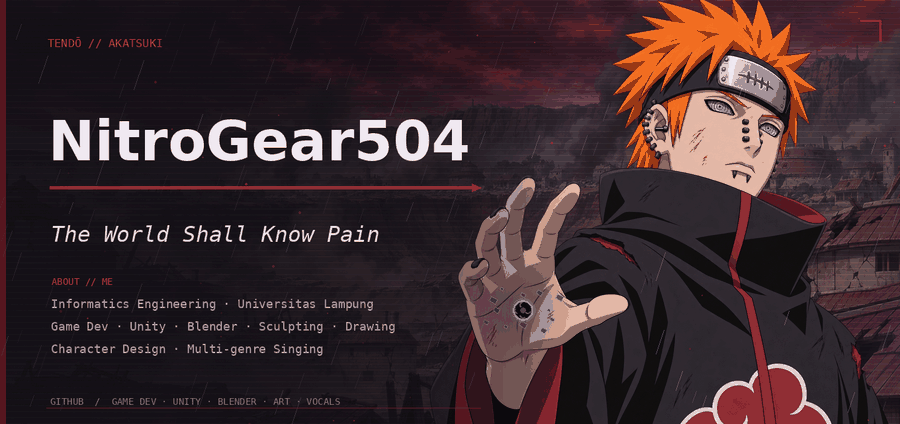
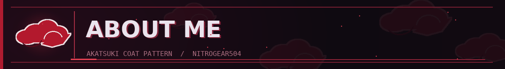
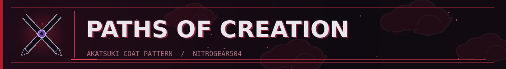
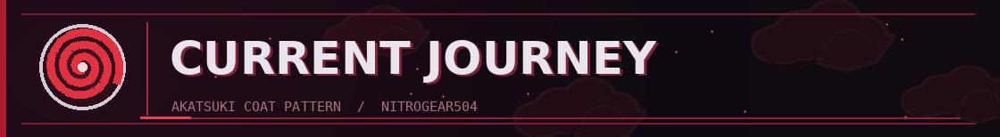
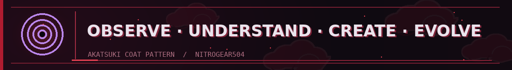

  

  

  *The World Shall Know Pain*

  **Informatics Engineering Student · Universitas Lampung · 2026**

  *Game Development · Unity · Blender · Sculpting · Drawing*  
  *Character Design · Multi-genre Singing*

---

  

I'm **NitroGear504**, an Informatics Engineering student fascinated by the space between **technology, visual art, and music**. My profile's aesthetic is inspired by **Pain (Yahiko / Deva Path)** from *Naruto*, with his Akatsuki cloak, Rinnegan, and Chibaku Tensei.

I'm still learning and experimenting. My goal is to build worlds, characters, and experiences of my own.

  

| Path | Interests |
| :--- | :--- |
| 🎮 **Game Development** | Unity, game design, interactive world-building |
| 🧊 **3D Creation** | Blender, 3D modeling, digital sculpting |
| 🎨 **Visual Art** | Drawing, illustration, character designing |
| 🎤 **Music** | Singing songs across multiple genres, vocal exploration |
| 💻 **Technology** | Programming, software development, creative tools |

  

- 🌱 Growing my programming skills
- 🎮 Exploring **Unity** and game development
- 🧊 Practicing **Blender** and digital sculpting
- 🎨 Developing my drawing and character design skills
- 🎤 Exploring different musical genres through singing

---

  

